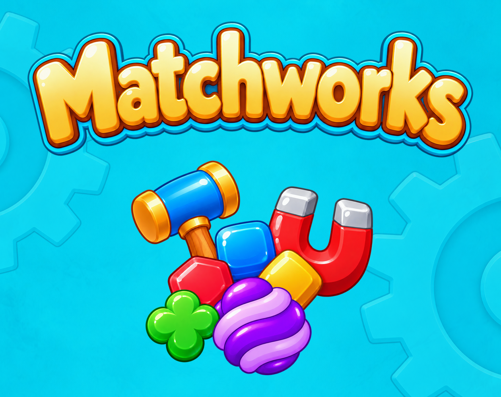

# Matchworks

A colorful Unity match-3 portfolio game set in a mechanical workshop.

**Current source version:** 1.0.1 · [Release notes](CHANGELOG.md)

**Play:** [alikb.itch.io/matchworks](https://alikb.itch.io/matchworks)

## The game

- 20 level layouts, introduced with interactive tutorials.
- Fireworks, hammers, magnets and special-tool combinations.
- Rusty parts, frozen grease, oil and multi-cell motors.
- Persistent inventory, a level map, 25 achievements and a move-funded reward wheel.
- English and Turkish localization, separate sound/music controls.
- Portrait UI that adapts to the viewport and safe area.

## Technical focus

The C# board model separates deterministic match/gravity/objective resolution from its animated presentation. Levels are JSON data loaded into one gameplay scene. The project includes a visual level editor, input handling for mouse/touch, local save data, and offline regression checks. Art direction, level layouts and playtesting were directed by Ali; AI-assisted tools were used during programming and asset production.

## Open the project

1. Install **Unity 6000.5.5f1**, including Web Build Support.
2. Clone the repository and open the project folder in Unity Hub. Unity restores the packages and generates its Library folder.
3. Restore the external opening sound described below.
4. Open `Assets/Scenes/SampleScene.unity` and press Play.

The runtime has no developer keyboard cheats or automatic test stock grants. Normal mouse/touch controls remain. The level authoring window is in the Workshop Match editor menu.

## External opening sound

Pixabay does not permit distributing its unmodified audio as a standalone asset. That MP3 is present in the playable game but intentionally absent from this public repository.

Download **Slow mouse wheel movement** by **ZoEdit** from [the original page](https://pixabay.com/sound-effects/technology-slow-mouse-wheel-movement-204710/), and save it as:

`Assets/WorkshopMatch/Resources/WorkshopMatch/Audio/opening_clockwork.mp3`

Keep the included `.meta` file so its GUID stays stable. Unity imports the clip when the file is restored. The game can otherwise open with a silent intro, but restoring the clip is required to reproduce the authored audio.

## Build

In Unity choose **Workshop Match → Build → WebGL Production Draft**. This creates a non-development WebGL player with gzip compression and decompression fallback. Package the contents of the output folder so `index.html` is at the ZIP root; exclude debug-information folders. The existing editor menu name retains its original wording.

Version 1.0.1 outputs to `Build/WebGL-Release-1.0.1/`. Build ZIPs are distributed separately and are not committed to this repository.

## Project layout

- `Assets/WorkshopMatch/Scripts/`: board model, animation/presentation, saves and UI.
- `Assets/WorkshopMatch/Resources/WorkshopMatch/Levels/`: 20 JSON levels.
- `Assets/WorkshopMatch/Editor/`: level authoring, asset importers and WebGL build helper.
- `Tests/RevisionChecks/`: C# model and layout regression checks.
- `Art/`: Blender sources and asset-production helpers.
- `Docs/`: current mechanics, technical notes and release instructions.

Library, build output, logs, temporary files and unrelated prototypes are excluded from version control.

## Validation and limits

The 1.0.1 release source passed 1,520 offline checks and both Unity/release C# compilation. The production WebGL build completed with 0 errors and 354 Unity/package warnings (353 shader warnings and one notice that the runtime Pipeline is disabled). The upload package is `Build/Matchworks-WebGL-1.0.1.zip`. Browser audio, save persistence and final itch.io behavior require a smoke test on the published build. Real mobile-device performance has not been certified.

See [CREDITS.md](CREDITS.md) for font, music and sound provenance. No blanket open-source license is granted for third-party assets; their original terms remain applicable. This repository is a portfolio/source project.
